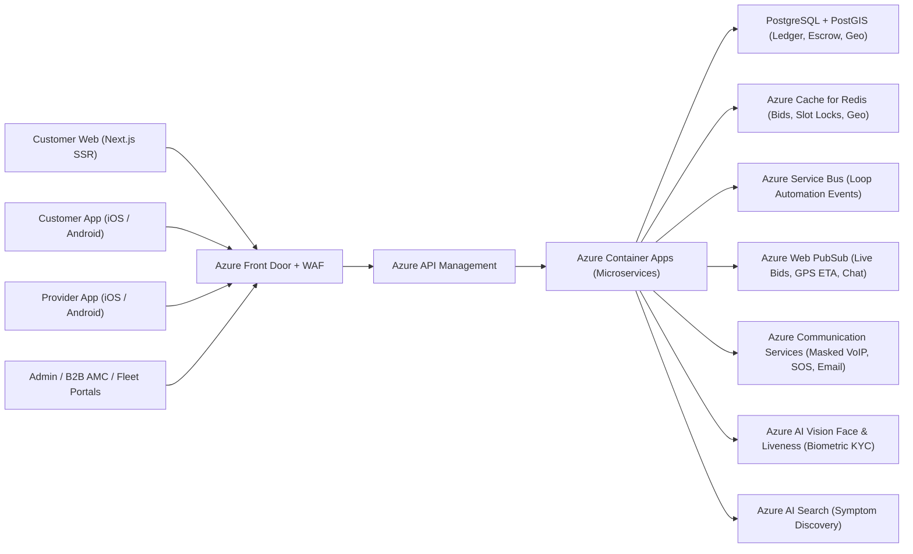

# Sipalu — Unified Home, Mechanical & Facility Services Marketplace

**Sipalu** merges our original **On-Demand Plumbing & Mechanical Marketplace PRD** (pilot-first in **Kathmandu Valley & Banepa**, featuring live competitive bidding, biometric KYC, automated calendar "Loop Setup", escrow milestones, anti-leakage controls, and SOS safety) with a complete reverse-engineering of the **Sajilo Sewa** ecosystem (10 service verticals, instant fixed-price catalog, tiered commissions `22% → 12%`, 30-day/6-month warranties, B2B AMC, Turnkey Renovation, and Academy)—architected natively for **Microsoft Azure**.

## Repository Blueprint & Artifacts

| Artifact | Scope | Link |
|---|---|---|
| **01. Reverse Engineering, Gap Analysis & Unified Requirements** | Synthesis of Sajilo Sewa teardown + Founder PRD, explicit **Gap Analysis & Improvements**, hybrid pricing (Instant + Live Bidding), 10-category expansion roadmap, and full FR/NFR catalog | [01-reverse-engineering-and-requirements.md](docs/01-reverse-engineering-and-requirements.md) |
| **02. Unified Product Requirements Document (PRD v2.0)** | Product vision, personas, automated **Loop Setup**, Hybrid Booking & Live Bidding specs, Biometric KYC, Automated Calendar, Ranking & Decay formula, Escrow & Anti-Leakage, KPIs, and **Banepa/Kathmandu Pilot → Nationwide** roadmap | [02-prd.md](docs/02-prd.md) |
| **03. Microsoft Azure Cloud Architecture** | Production Azure blueprint (`Central India` / `South India` DR) adding **Azure AI Vision Face Liveness**, **Real-Time Bidding & Geo-Locking**, **Escrow Double-Entry Ledger**, **GPS Anti-Leakage Engine**, **Web PubSub**, **ACS Call Masking/SOS**, and FinOps | [03-azure-cloud-architecture.md](docs/03-azure-cloud-architecture.md) |
| **04. Standard Operating Procedures (SOPs)** | 10 unified SOPs covering Biometric KYC & Random Selfie Checks, Hybrid Dispatch & Live Bidding, Escrow/Cash Float & Payouts, 48h Disputes + 30d/6m Warranties, Anti-Leakage & SOS Safety, B2B AMC, Turnkey Projects, Privacy/Grievance, and Azure SRE | [04-sops.md](docs/04-sops.md) |
| **05. PostgreSQL + PostGIS Database Schema** | 5 ordered SQL migrations (GiST conflict-free calendar locks, Biometric KYC, Hybrid Bookings/Bids, Double-Entry Ledger/Escrow/Cash Float, Disputes/Warranties/SOS/AMC) + Banepa/Kathmandu pilot seed | [db/migrations/](db/migrations/) & [001_pilot_banepa_kathmandu_seed.sql](db/seeds/001_pilot_banepa_kathmandu_seed.sql) |
| **06. OpenAPI 3.1 Contract** | Complete Phase 1 Pilot & Core Marketplace REST API specification ready for Azure API Management import | [openapi.yaml](api/openapi.yaml) |
| **07. Azure Bicep IaC** | Modular Bicep templates (`networking`, `security-observability`, `postgresql`, `redis-servicebus`, `realtime-ai-kyc`, `container-apps`, `edge-apim`) with `pilot-dev`, `pilot-prod`, and `scale-prod` parameter profiles | [main.bicep](infra/bicep/main.bicep) & [infra/README.md](infra/README.md) |

## Unified Platform Architecture Overview

## Strategic Rollout Path
1. **Phase 1 — Closed Local Pilot (Banepa & Select Kathmandu Valley Wards):** Plumbing & Mechanical focus; validate Biometric KYC, Hybrid Booking (Instant Rate-Card + Live Bidding), Automated Calendar Loop, Cash Float + eSewa/Escrow, and GPS Tracking.
2. **Phase 2 — Valley-Wide Scale & Financial Maturity:** Full Kathmandu Valley coverage; add Electrical, AC/Appliances, Washing Machine, Cleaning, Computer Repair; launch Tiered Commissions (`22% → 12%`), Khalti/Fonepay/ConnectIPS, Twice-Daily Payouts, Loyalty Points, and Service Business Fleet Mode.
3. **Phase 3 — Commercial B2B AMC, Turnkey Projects & Nationwide Expansion:** Launch B2B AMC (`<2h` SLA), Turnkey Renovation (`Sipalu Project` with 6-month warranty), Academy LMS, EV Charger & Bluebook verticals, and expand to Pokhara, Butwal, and Biratnagar.
