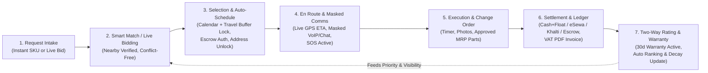
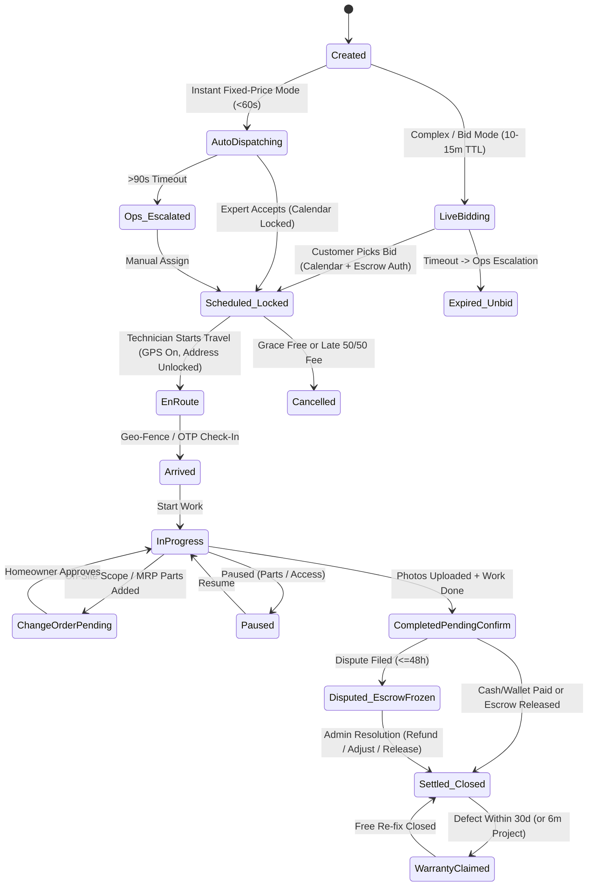
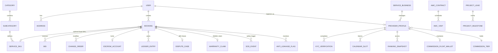

# 02 — Unified Product Requirements Document (PRD v2.0): Sipalu Platform

| Parameter | Details |
|---|---|
| **Product Name** | **Sipalu** (On-Demand Home, Mechanical & Facility Services Marketplace) |
| **Document Version** | 2.0 (Merged Founder PRD v1.0 + Sajilo Sewa Parity & Improvements) |
| **Date** | November 23, 2026 |
| **Target Market & Pilot** | Nepal — **Phase 1 Pilot** in **Banepa & select Kathmandu Valley wards** → Valley-wide → Nationwide (Pokhara, Butwal, Biratnagar) |
| **Initial Pilot Verticals** | On-Demand & Scheduled **Plumbing & Mechanical Repair Services** → expanding to all **10 Home/Office Verticals** |
| **Target Cloud** | Microsoft Azure (`Central India` Primary / `South India` DR) |
| **Status** | Production-Ready Architecture & Pilot Validation Baseline |

---

## 1. Executive Summary & Product Vision

### Product Vision
Build Nepal's most trusted, automated home and facility services marketplace—starting with urgent and scheduled **Plumbing & Mechanical repairs** in **Kathmandu Valley & Banepa** and scaling to all **10 residential & commercial service verticals**—combining **biometrically verified technicians**, **hybrid pricing (Instant Rate-Card + Live Competitive Bidding)**, **Escrow protection**, **30-day workmanship warranties**, and a self-sustaining automated **"Loop Setup"**.

### Core Problems Solved
- **For Homeowners & Businesses:** Eliminates unverified strangers, opaque/haggled pricing, unreliable arrival times, and post-repair ghosting.
- **For Local Technicians & Service Shops:** Eliminates irregular leads, payment delays, and lack of portable reputation—providing steady digital work, automated scheduling, tiered commissions (`22% → 12%`), and same-day digital payouts.
- **For Operations:** Automates onboarding, dispatch, calendar conflict locking, anti-leakage monitoring, escrow settlement, and ranking recalculation with minimal manual intervention.

---

## 2. Target Audience & User Personas

| Persona | Profile | Primary Needs | Key Pain Points |
|---|---|---|---|
| **Homeowner / Customer** | Urban & peri-urban residents (Kathmandu Valley, Banepa) needing urgent repairs (burst pipes, clogged drains, pump/geyser failures) or routine maintenance | `<60s` booking or fair live quotes, verified technician safety, live GPS ETA, 30-day warranty, flexible Cash/Wallet/Escrow pay | Inconsistent rates, late/no-show technicians, unverified strangers entering homes, post-repair leaks |
| **Independent Technician** | Local plumbers, mechanical/electrical/appliance specialists | Steady local leads, fair competitive pricing, automated calendar, low commission at scale, fast payouts, verified reputation | Irregular job volume, haggling, unpaid travel/cancellations, no portable digital track record |
| **Service Business Partner** | Established repair shops & cleaning/maintenance teams (2–20 staff) | Digital storefront, multi-technician fleet dispatch, consolidated billing & settlement | Manual phone coordination, poor online discovery |
| **B2B Facility Manager** | Offices, hospitals, restaurants, commercial buildings | Single Annual Maintenance Contract (AMC) across 5 trades, preventive visits, VAT invoices, `<2h` emergency SLA | Managing multiple unreliable vendors, equipment downtime |
| **Platform Administrator & Ops** | KYC reviewers, dispatchers, QA/warranty, finance, Grievance Officer | Fast biometric KYC queues, live SLA/SOS monitoring, automated escrow/float reconciliation, objective dispute evidence | Manual KYC bottlenecks, off-platform cash leakage, billing disputes |

---

## 3. End-to-End Automated Operational Loop ("Loop Setup")

The platform runs on a closed-loop automated workflow requiring human intervention only on SLA exceptions, disputes, or SOS events:

1. **Request Intake:** Customer selects a fixed-price SKU (*Instant Mode*) or submits an issue with text/voice/photos/video, GPS pin, and urgency (*Live Bidding Mode*).
2. **Smart Match / Live Bidding:** System broadcasts to nearby, available, biometrically verified, conflict-free technicians (showing only approximate neighborhood/distance).
3. **Selection & Auto-Scheduling:** Customer accepts a bid (or instant match confirms). System **locks the technician's calendar** (start time + duration + travel buffer), unlocks the exact customer address, and authorizes **Escrow** (if applicable).
4. **Dispatch & Masked Comms:** Technician taps `En Route` -> triggers live GPS map ETA, masked in-app calling/chat, and active SOS safety monitoring.
5. **Execution & Change Orders:** Technician checks in, completes work, captures before/after photos, and submits any on-site **Change Order** (extra labor/MRP spare parts) for explicit customer in-app approval.
6. **Settlement & Invoicing:** Settles via **Cash (auto-deducting commission from technician float)**, **eSewa/Khalti/Fonepay/ConnectIPS**, or **Escrow/Milestone release (OTP-confirmed)**; generates VAT-compliant PDF invoice.
7. **Two-Way Feedback & Ranking Loop:** Both parties rate each other; the Ranking Engine recalculates visibility score, tier progress, and activity decay—immediately feeding back into step 2.

---

## 4. Detailed Feature Specifications & Epics

### Epic 1: Strict Biometric Onboarding, KYC & Academy
- **Government ID Capture:** Mandatory upload of valid Nepali **Citizenship Certificate (*Nagarikta*)** or **National ID (*Rastriya Parichayapatra*)**, front and back.
- **Biometric Facial Recognition & Liveness Check:** Real-time selfie capture with active liveness detection matched against the government ID photo via **Azure AI Vision Face API** (auto-pass threshold `>= 0.85`, manual review `0.70–0.84`, auto-reject `< 0.70`).
- **Periodic Random Selfie Re-Checks:** Randomized liveness checks before going online (e.g., every 14–30 days or on anomaly trigger) to prevent account sharing.
- **Mandatory Financial Account Linking:** Must link and verify a valid Nepali bank account and/or eSewa/Khalti wallet during onboarding before activation.
- **Skill Classification & Academy Orientation:** Select specialties (Plumbing, Mechanical/Pump/Geyser, etc.), service radius, and complete practical assessment/orientation (**Sipalu Academy**).
- **Lifecycle States:** `Pending Submission → Under Admin Review → Verified/Active` (or `Rejected [Actionable Reason]` / `Suspended`).

### Epic 2: Hybrid Discovery, Instant Booking & Live Bidding
- **Dual-Mode Routing:**
  - **Mode A — Instant Fixed-Price (`<60s`):** Standardized SKUs (e.g., Tap Leakage `Rs 350`, Flush Tank `Rs 650`) use upfront unit pricing (`Labor = Rate × Units`), rolling 7-day calendar, and 2-hour slots (`8AM–10AM` to `4PM–6PM`), with 60-second auto-dispatch.
  - **Mode B — Live Competitive Bidding (Dynamic Pricing):** Complex or diagnostic mechanical/plumbing jobs broadcast to nearby verified technicians.
    - *Bid Payload:* Quoted labor price (NPR), ETA, estimated duration, and parts inclusion note.
    - *Comparison UI:* Real-time list showing price, Verified badge, star rating, completed job count, distance/ETA, and profile summary.
    - *Guardrails:* Time-boxed windows (**10–15 min** for Urgent/ASAP; configurable for Scheduled), max **1 bid edit** (downward or capped) to prevent bait-and-switch, and min/max price sanity warnings.
- **On-Site Scope Change Protocol (Change Orders):** If inspection reveals additional labor or spare parts, technician submits an itemized in-app **Change Order** (parts billed at **MRP + receipt photo**, zero markup). Work pauses on extra scope until homeowner taps **Approve**.
- **Symptom-Based Search:** Natural-language queries (*"geyser not heating"*, *"motor running no water"*) mapped to SKUs/categories via **Azure AI Search**.

### Epic 3: Dual-Side GPS, Masked Comms & Automated Calendar
- **Homeowner Location Privacy:** Approximate neighborhood/distance shown during bidding; exact address & GPS pin unlocked only after booking confirmation.
- **Live En-Route Tracking:** Real-time technician GPS + dynamic ETA via **Azure Web PubSub** & **Azure Maps**.
- **Masked Calling & Auditable Chat:** Proxy VoIP/PSTN calling (**Azure Communication Services**) hides personal phone numbers; in-app text/photo chat serves as immutable dispute evidence.
- **Automated Calendar & Conflict Prevention:**
  - Accepting a job auto-blocks `[Start_Time - Travel_Buffer, Start_Time + Est_Duration + Travel_Buffer]`.
  - Bidding engine hard-blocks technicians from bidding on overlapping time windows.
  - Real-time states: `Available`, `En Route`, `On Job`, `Scheduled Busy`, `Offline`.
  - Structured reschedule flow requiring mutual confirmation + automated push/SMS reminders.

### Epic 4: Rating, Automated Ranking & Decay Engine
- **Two-Way Ratings:**
  - Homeowner rates technician (`1–5 stars` + sub-tags: *Punctuality, Workmanship, Cleanliness, Pricing Transparency* + comment/photos).
  - Technician rates homeowner cooperation (`1–5 stars` + private safety/cooperation flags).
- **Composite Visibility Score (`0–100`):**
  $$\text{Score} = 0.35 R_{\text{norm}} + 0.25 C_{\text{rate}} + 0.15 B_{\text{speed}} + 0.15 (1 - X_{\text{cancel}}) + 0.10 T_{\text{tier}} - D_{\text{inactivity}}$$
  where $R_{\text{norm}}$ is Bayesian-smoothed rating, $C_{\text{rate}}$ is completion rate, $B_{\text{speed}}$ is median bid/accept speed, $X_{\text{cancel}}$ is unexcused cancellation rate, $T_{\text{tier}}$ is commission tier weight, and $D_{\text{inactivity}}$ is **Inactivity / Zero-Job Decay** (applied after 14 days with zero completed jobs).
- **New Provider Grace Period:** Newly verified technicians receive a **"New Verified"** badge and a 14-day (or first 5 jobs) cold-start boost before inactivity decay applies.

### Epic 5: Flexible Payments, Escrow, Tiered Commissions & Anti-Leakage
- **Payment Methods:**
  1. **Cash on Completion:** Supported with mandatory **Prepaid Commission Float** (`min NPR 500` recommended; cash jobs auto-pause if float `< -NPR 300` until topped up or netted against digital earnings).
  2. **Digital Wallets & Banking:** **eSewa, Khalti, Fonepay QR, ConnectIPS, Card**.
  3. **Escrow & Milestone Protection:** Mandatory or optional for high-value jobs (`> NPR 5,000`) and multi-stage repairs/renovations; funds held in escrow ledger and released upon homeowner in-app confirmation / completion OTP.
- **Tiered Commission Ladder (Labor Only):**

| Tier | Lifetime Jobs | Commission | Expert Keep | Perks & Eligibility |
|---|---|---|---|---|
| **Trainee** | 0 – 25 | 22% | 78% | Uniform & ID kit, NPR 15k tool loan, weekly Academy coaching |
| **Verified** | 26 – 100 | 18% | 82% | Priority dispatch, NPR 25L liability insurance, 5-day sick allowance |
| **Pro** | 101 – 400 | 15% | 85% | Top search/bid placement, NPR 25k gear loan, quarterly bonus pool |
| **Elite** | 400+ | 12% | 88% | Job choice flexibility, health cover, annual revenue share |

  - *Promotion Rule:* Auto-evaluated month-end (`rating >= 4.4` required to advance; demotion only after 2 consecutive months `< 4.0` post-coaching).
  - *100% Pass-Through (0% Commission):* Flat `NPR 100` visiting/travel fee, `100%` customer tips, and spare parts at `MRP`.
- **Payout Cadences:** **Instant (2h, `NPR 25` fee)** via eSewa/Khalti/IME; **Same-Day Batch (`11 AM` & `5 PM`, free)** via wallets + ConnectIPS; **Weekly Bank Settle (Monday, free)**.
- **Anti-Leakage Controls:**
  - *Value Lock-in:* 30-day warranty, escrow protection, dispute support, and VAT receipts apply **only** to in-app completed bookings.
  - *Technical:* Masked calling/chat pre-arrival; automated **GPS Proximity-Cancellation Detection** (flags technician who cancels an accepted job after coming within `300m` of customer pin) + bid-to-completion anomaly alerts.

### Epic 6: Safeguards — Cancellations, 48h Disputes, 30-Day Warranty & SOS
- **Cancellation Policy:**
  - *Customer:* Free within **5-minute grace window** after bid acceptance or `> 2 hours` before scheduled slot. Late cancel after technician is `En Route` / on-site incurs call-out fee split **50/50** (platform/technician).
  - *Technician:* Repeated post-accept cancellations or no-shows reduce ranking score and trigger automated cooldowns (`24h → 72h → Admin Review`).
- **48-Hour Dispute & Escrow Freeze:** Either party can file within **48 hours** of completion; active disputes **automatically freeze pending escrow payouts**; Admin resolves within **24–48 hours** using objective evidence (bid, Change Orders, photos, chat, GPS logs).
- **30-Day Service & 6-Month Project Warranty:** Free revisit for workmanship defects within 30 days (6 months for turnkey projects); platform pays re-fix technician hourly from warranty reserve.
- **Personal Safety & SOS:** Pre-arrival verified photo/badge display + prominent **SOS Emergency Button** active during `En Route` and `On Job` states (triggers immediate Ops alert, shares live GPS snapshot, and bridges emergency call).

### Epic 7: B2B AMC, Fleet Mode & Turnkey Renovation (Phase 2–3)
- **Service Business Fleet Dashboard:** Shop owners manage multi-technician rosters, assign jobs, and settle team revenue.
- **B2B AMC Portal:** Bundled contracts (Plumbing, Electrical, Computer, AC, Cleaning), recurring preventive visit scheduler, asset registry, supervisor reports, and `< 2 hour` emergency SLA.
- **Turnkey Renovation (`Sipalu Project`):** Free 48h site survey -> itemized BOQ -> Escrow milestone billing -> PM supervision -> 6-month warranty.

---

## 5. Unified Booking & Escrow State Machine

---

## 6. High-Level Domain Data Model

---

## 7. Key Performance Indicators (KPIs)

| Category | Metric | Pilot Target (Phase 1) | Scale Target (Phase 2–3) |
|---|---|---|---|
| **Liquidity** | Time to First Bid (Bidding) / Match Time (Instant) | `< 3 min` / `< 60s` | `< 90s` / `< 45s` |
| **Liquidity** | Average Bids per Bidding Request | `>= 3 bids` | `>= 4 bids` |
| **Conversion** | Bid-to-Booking Conversion Rate | `>= 45%` | `>= 60%` |
| **Reliability** | On-Time Arrival & Job Completion Rate | `>= 88%` / `>= 92%` | `>= 94%` / `>= 96%` |
| **Trust & Safety** | Average Job Rating & Dispute Rate | `>= 4.5★` / `< 2.0%` | `>= 4.7★` / `< 1.2%` |
| **Warranty** | 30-Day Warranty Re-fix Rate | `< 3.0%` | `< 1.8%` |
| **Monetization** | Digital/Escrow Payment Share | `>= 40%` | `>= 70%` |
| **Anti-Leakage** | Suspected Off-Platform Leakage Rate | `< 5%` | `< 2%` |
| **Retention** | 90-Day Repeat Homeowner & Monthly Active Tech | `>= 35%` / `>= 80%` | `>= 48%` / `>= 90%` |

---

## 8. Phased Pilot & Commercial Rollout Plan

| Phase | Geography & Verticals | Timeline | Core Deliverables & Validation Goals |
|---|---|---|---|
| **Phase 1 — Closed Local Pilot (MVP)** | **Banepa & select Kathmandu Valley wards**; **Plumbing & Mechanical** | Weeks 1–10 | Customer & Provider Mobile Apps + Admin Web Portal + SEO Web MVP; Biometric KYC + Liveness + Bank/eSewa Linking; Hybrid Booking (Instant + Live Bidding); Automated Calendar Loop; Dual-Side GPS & Masked Calling; Cash + Float + eSewa + Escrow; 48h Dispute Freeze + 30d Warranty + SOS; validate bidding speed, KYC friction, offline sync, and unit economics |
| **Phase 2 — Loop Optimization & Valley Scale** | **Full Kathmandu Valley** (KTM, Lalitpur, Bhaktapur); + Electrical, AC/Appliances, Washing Machine, Cleaning, Computer Repair | Weeks 11–18 | Tune bidding timeouts, ranking decay weights & anti-leakage ML rules from pilot telemetry; launch **4-Tier Commission Ladder (`22% → 12%`)**, **Khalti/Fonepay/ConnectIPS**, **Instant (2h) & Twice-Daily Payouts**, Loyalty Points & Promos, **Service Business Fleet Mode**, and **Azure AI Search** symptom discovery |
| **Phase 3 — B2B AMC, Turnkey Projects & Nationwide** | **Pokhara, Butwal, Biratnagar**; All 10 Verticals (+ EV Charger, Bluebook) | Weeks 19–26 | Launch **B2B AMC Portal** (`<2h` SLA, preventive maintenance scheduler), **Sipalu Project** Turnkey Renovation (48h survey, BOQ, Escrow milestones, 6-month warranty), **Sipalu Academy LMS**, and Form 11 / PF-SSF automation |
