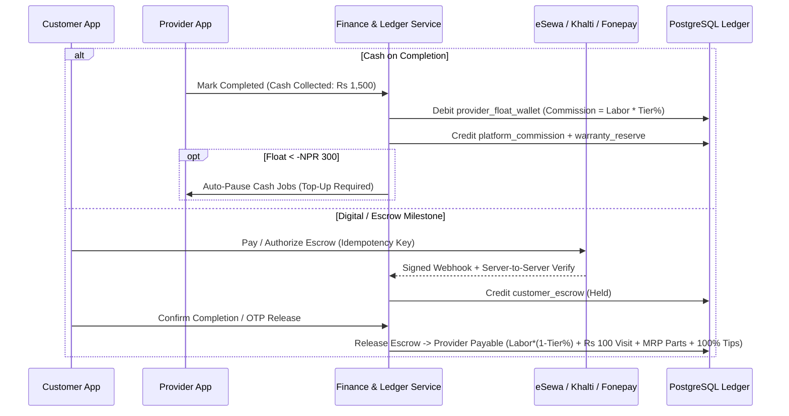
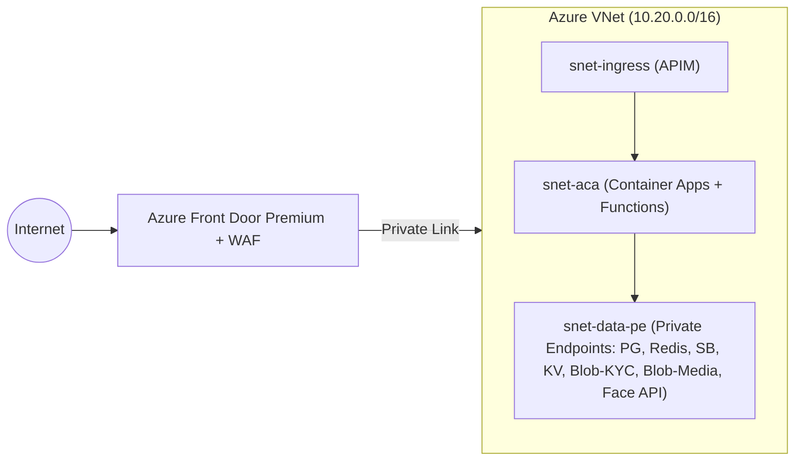

# 03 — Microsoft Azure Cloud Architecture Specification (Unified v2.0)

## 1. Architectural Principles & Region Strategy

- **Primary Region:** `Central India` (Pune) — lowest round-trip latency to Kathmandu Valley & Banepa (`~30–45ms`), full 3-AZ zone redundancy, complete PaaS + Azure AI Vision support.
- **DR Region:** `South India` (Chennai) — paired region for Geo-Redundant Storage (RA-GRS), PostgreSQL geo-backups, and Bicep warm-standby failover.
- **Compute Philosophy:** **Azure Container Apps (ACA)** + **Azure Functions** (KEDA autoscaling, Dapr pub/sub, scale-to-zero for non-prod/pilot efficiency) so Phase 1 Banepa/Kathmandu pilot runs cost-effectively while scaling seamlessly to nationwide volume without re-architecture.
- **Zero-Trust Security:** Private Endpoints for all data stores, biometric KYC storage, Service Bus, and Key Vault; Managed Identities everywhere; strict PII/biometric isolation.
- **Peri-Urban Offline Resilience:** Designed for intermittent 3G/4G around Banepa and outskirts using mobile store-and-forward queues, resumable Blob SAS uploads, and SMS fallback for critical dispatch/SOS events.

---

## 2. Unified Azure System Architecture

```mermaid
flowchart TB
    subgraph Clients["Client Tier (Offline-Resilient Mobile + SEO Web)"]
        CW["Customer Web (Next.js SSR)"]
        CM["Customer App (iOS / Android)"]
        PM["Provider App (iOS / Android + Local SQLite Queue)"]
        ADM["Admin / KYC / Fleet / B2B AMC Web Portals"]
    end

    AFD["Azure Front Door Premium + OWASP WAF + DDoS"]
    APIM["Azure API Management (JWT, Rate Limit, Webhook Validation)"]
    ENTRA["Microsoft Entra External ID + Custom SMS OTP"]

    Clients --> AFD --> APIM
    APIM --> ENTRA

    subgraph Compute["Azure Container Apps Environment (Multi-AZ, VNet Integrated)"]
        SSR["Web SSR App"]
        KYC["Identity, Biometric KYC & Academy Service"]
        CAT["Catalog, Geo-Zone & Ranking Service"]
        BID["Hybrid Booking, Live Bidding & Calendar Service"]
        EXEC["Execution, Change Order, Dispute & Warranty Service"]
        FIN["Payments, Escrow, Cash Float & Ledger Service"]
        AMC["B2B AMC, Fleet & Renovation Project Service"]
        SAFE["Anti-Leakage & SOS Safety Service"]
    end

    APIM --> SSR & KYC & CAT & BID & EXEC & FIN & AMC & SAFE

    subgraph Workers["Azure Functions / ACA Jobs (Async Loop Automation)"]
        F_BID["Bid Expiry & Sanity Guardrails"]
        F_RANK["Ranking, Activity Decay & Monthly Tier Cron"]
        F_PAY["Twice-Daily/Weekly Payouts & Gateway Recon"]
        F_LEAK["GPS Proximity Anti-Leakage Detector"]
        F_PDF["VAT PDF Invoice & Form 11 Generator"]
        F_DEL["7-Day Privacy PII Anonymizer"]
    end

    subgraph RealtimeAI["Real-Time, Comms & AI PaaS"]
        FACE["Azure AI Vision Face API + Active Liveness"]
        WPS["Azure Web PubSub (Live Bids, GPS ETA, Chat)"]
        ACS["Azure Communication Services (Masked VoIP/PSTN, SOS, Email, SMS)"]
        AIS["Azure AI Search (Symptom NL Discovery)"]
        NH["Azure Notification Hubs (FCM / APNs)"]
    end

    KYC --> FACE
    BID & EXEC --> WPS
    EXEC & SAFE --> ACS
    CAT --> AIS
    BID & EXEC & SAFE --> NH

    subgraph Data["Data, Messaging & Security Tier (Private Endpoints Only)"]
        PG[("Azure Database for PostgreSQL Flexible + PostGIS")]
        REDIS[("Azure Cache for Redis (Bid TTLs, Calendar Locks, Live Geo)")]
        SB["Azure Service Bus (Loop Domain Events + DLQ)"]
        BLOB["Azure Blob Storage (Encrypted KYC Vault, Photos, PDFs)"]
        KV["Azure Key Vault (Merchant Secrets, CMK, JWT Keys)"]
    end

    KYC & CAT & BID & EXEC & FIN & AMC & SAFE --> PG
    BID & CAT & SAFE --> REDIS
    Compute <--> SB
    Workers <--> SB
    KYC & EXEC & F_PDF & AMC --> BLOB
    Compute & Workers --> KV

    subgraph External["External Integrations"]
        GW["Payment Rails (eSewa, Khalti, Fonepay QR, ConnectIPS, Banks)"]
        MAPS["Azure Maps / Google Maps (Routing, ETA, Geo-Fence)"]
    end

    FIN & F_PAY <--> GW
    BID & EXEC & SAFE --> MAPS
```



---

## 3. Azure Service Mapping for Merged Capabilities

| Platform Capability | Azure Service | Architecture & Configuration Details |
|---|---|---|
| **Biometric KYC & Random Selfie Checks** | **Azure AI Vision Face API (Verify + Active Liveness) + Private Blob Vault** | Compares Citizenship/National ID photo against live selfie with active liveness session token (`>=0.85` auto-pass, `0.70–0.84` manual review queue). KYC images stored in a separate encrypted Blob container with 5-minute RBAC-gated SAS URLs and zero public access |
| **Live Competitive Bidding Engine** | **Azure Cache for Redis + Azure Web PubSub + Service Bus** | Bidding rooms use Redis TTL keys (`10–15m` urgent window), atomic Lua scripts to enforce bid-edit caps & sanity bounds, and **Web PubSub** groups (`booking:{id}:bids`) to stream new bids to the homeowner in `<300ms` |
| **Automated Calendar & Conflict Locking** | **PostgreSQL Exclusion Constraints (`btree_gist`) + Redis Distributed Lock** | Prevents double-booking at database level: `EXCLUDE USING gist (provider_id WITH =, tstzrange(start_at - travel_buf, end_at + travel_buf) WITH &&)` ensures a technician can never accept or bid on overlapping slots |
| **Dual-Side GPS Privacy & Live ETA** | **Azure Web PubSub + Redis GeoHash + Azure Maps** | During bidding, API returns only rounded neighborhood centroid/distance (`~500m` jitter). Exact lat/lng & address unlock only in `Scheduled_Locked` state. Once `En Route`, GPS pings publish every 5s via Web PubSub |
| **Masked Calling & SOS Emergency Bridge** | **Azure Communication Services (ACS)** | Proxy VoIP/PSTN call automation hides personal phone numbers. Tapping **SOS** triggers high-priority Service Bus event, snaps current GPS coordinates, alerts Ops console, and initiates a 3-way ACS emergency bridge |
| **Escrow, Cash Float & Double-Entry Ledger** | **Azure Database for PostgreSQL (ACID Serializable) + Azure Durable Functions** | Every transaction writes balanced double-entry rows across `customer_escrow`, `platform_commission`, `provider_float_wallet`, `provider_payable`, and `warranty_reserve`. Disputes atomically set `escrow_status = FROZEN` |
| **GPS Anti-Leakage Anomaly Engine** | **Azure Functions + PostGIS + Log Analytics** | Triggered on `BookingCancelled` after `Scheduled_Locked`: checks if technician's GPS trail entered within `300m` of customer pin before cancelling, or if rolling bid-to-completion ratio drops `>2σ` below cohort mean → writes `AntiLeakageFlag` to Admin queue |
| **Ranking & Activity Decay Engine** | **Azure Functions (Event + Nightly Timer) + Redis Sorted Sets** | Recalculates composite score on every completed job/rating and runs nightly inactivity decay (`>14 days` zero jobs) while respecting the 14-day `New Verified` grace flag |
| **Natural Language Symptom Discovery** | **Azure AI Search (Hybrid Vector + BM25)** | Maps English & Romanized/Devanagari Nepali symptom queries (*"pani motor chaldaina"*, *"kitchen tap leaking"*) to instant SKUs or bidding categories |
| **Peri-Urban Offline Sync (Banepa)** | **Mobile SQLite Queue + Idempotency Keys + Blob Chunked SAS** | Provider app queues status transitions (`Arrived`, `Completed`, `ChangeOrder`, photos) with signed local timestamps & GPS coords, syncing idempotently when 4G returns; critical dispatch alerts fall back to ACS/local SMS gateway |

---

## 4. Critical End-to-End Technical Flows

### 4.1 Hybrid Loop: Live Bidding -> Auto-Calendar Lock -> Escrow Auth
1. Homeowner posts Plumbing/Mechanical request -> `Booking Service` stores exact pin privately, masks coordinates to `~500m` neighborhood radius, and queries `Redis GEOSEARCH` + `PostgreSQL` (excluding providers with overlapping `tstzrange` calendar slots or suspended cash floats).
2. Broadcasts job offer via **Notification Hubs** + **Web PubSub**; sets `15m` Redis TTL timer (or `10m` urgent).
3. Technicians submit bids -> validated for calendar conflict, edit cap (`<=1`), and sanity bounds -> streamed live to Homeowner via **Web PubSub**.
4. Homeowner selects winning bid -> single PostgreSQL ACID transaction:
   - Inserts `calendar_slot` (enforced by GiST exclusion constraint).
   - Unlocks exact address for winning technician; notifies losing bidders.
   - If high-value/milestone job, initiates **eSewa/Khalti Escrow Hold** via `Finance Service`.

### 4.2 Cash-Job Commission Float & Escrow Settlement Flow


---

## 5. Network Isolation, Biometric Security & Compliance



- **Biometric & KYC Data Protection:** Citizenship/National ID images and facial biometric session artifacts are encrypted with Customer-Managed Keys (CMK) in **Azure Key Vault**, isolated in `blob-kyc-vault`, never cached by CDN, and accessible strictly by `KYC_Reviewer` RBAC roles with full audit logging.
- **Payment & Webhook Hardening:** Every eSewa/Khalti/Fonepay/ConnectIPS callback passes APIM signature verification + server-to-server status lookup before writing ledger entries.
- **Right to Erasure (`7 working days`):** `AnonymizeUserPipeline` scrubs PII columns while preserving anonymized `booking_id` and `ledger_entry` rows required for Nepal VAT/tax audits.

---

## 6. High Availability, DR & Pilot-to-Scale FinOps Estimate

### 6.1 Resiliency Targets
- **RPO:** `< 5 minutes` (PostgreSQL continuous WAL PITR + RA-GRS storage).
- **RTO:** `< 30 minutes` (`< 60s` automatic intra-region zone failover; `< 30m` cross-region Bicep DR).

### 6.2 Phased Azure FinOps Estimate (USD / Month)

| Azure Component | Phase 1 Pilot (Banepa + KTM Wards, ~5k MAU) | Phase 2–3 Scale (Valley + Nationwide, ~50k+ MAU) |
|---|---|---|
| Azure Front Door + WAF | Standard (~$45) | Premium + WAF (~$220–$350) |
| Azure API Management | Consumption / Basic v2 (~$50–$150) | Standard v2 (~$175) |
| Azure Container Apps + Functions | Consumption scale-to-zero (~$120) | Multi-AZ min replicas (~$300–$480) |
| Azure PostgreSQL Flexible (PostGIS) | Burstable B2ms / D2ds (~$95) | General Purpose D2ds_v5 Zone-HA (~$320) |
| Azure Cache for Redis | Basic C0 / Standard C1 (~$45) | Standard C1 / Enterprise (~$120–$180) |
| Azure Service Bus + Web PubSub | Standard / Free-to-Standard (~$45) | Standard S1 (~$110) |
| Azure AI Vision Face + AI Search | Pay-per-KYC + Basic Search (~$65) | Standard S1 Search + Face (~$150–$220) |
| Blob Storage + Key Vault + Monitor | LRS + 15GB Logs (~$45) | GRS + 60GB Logs (~$120) |
| **Estimated Monthly Cloud Total** | **~$510 – $610 / mo** *(+ ACS usage)* | **~$1,515 – $1,985 / mo** *(+ ACS usage)* |

### 6.3 IaC Repository Structure (`infra/bicep/`)
```text
infra/bicep/
├── main.bicep
├── modules/
│   ├── networking.bicep         # VNet, NSGs, Private DNS Zones
│   ├── frontdoor-waf.bicep      # Front Door + OWASP WAF + Rate Limits
│   ├── apim.bicep               # API Management + Webhook Policies
│   ├── container-apps.bicep     # ACA Environment + ACR + Functions + Managed Identities
│   ├── postgresql.bicep         # PostgreSQL Flexible + PostGIS + btree_gist + PE
│   ├── redis-servicebus.bicep   # Redis + Service Bus Topics/DLQs + PE
│   ├── realtime-ai-kyc.bicep    # Web PubSub + ACS + Face API + AI Search + Notification Hubs
│   └── security-observability.bicep # Key Vault (CMK) + KYC Vault Blob + App Insights + Alerts
└── parameters/
    ├── pilot-dev.bicepparam
    ├── pilot-prod.bicepparam
    └── scale-prod.bicepparam
```
